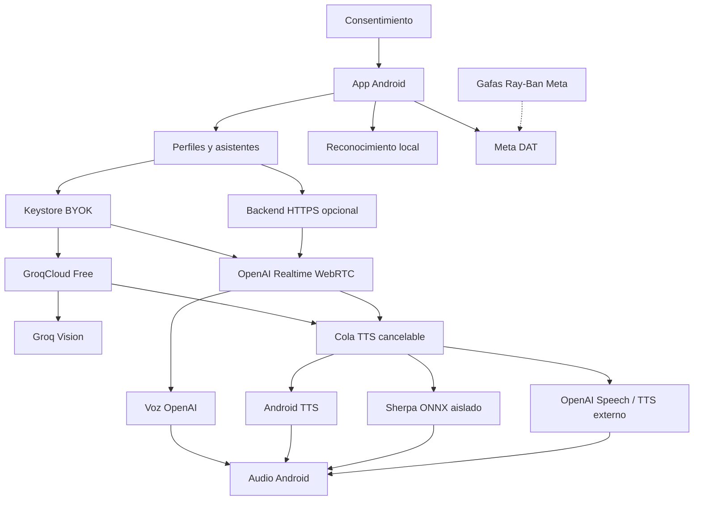

# PbtMetaGPT

<p align="center"></p>

<p align="center">
  <strong>Tu asistente de voz, tus reglas.</strong><br>
  Asistente de voz Android con GroqCloud, Qwen3-TTS, modelos locales y conexión con gafas Meta Wearables.
</p>

<p align="center">
  <a href="https://github.com/PbtServers/PbtMetaGPT/actions/workflows/android.yml"></a>
  <a href="https://github.com/PbtServers/PbtMetaGPT/blob/master/LICENSE"></a>
  
  
</p>

<p align="center">
  <a href="https://github.com/PbtServers/PbtMetaGPT/actions/workflows/android.yml">APK candidata en GitHub Actions</a> ·
  <a href="#instalación">Instalación</a> ·
  <a href="#primeros-pasos">Primeros pasos</a> ·
  <a href="docs/PROGRESO.md">Progreso</a> ·
  <a href="https://github.com/PbtServers/PbtMetaGPT/issues">Reportar un problema</a>
</p>

> [!IMPORTANT]
> **Versión candidata 0.5.0-rc1.** PbtMetaGPT es independiente de Meta, OpenAI y Marvel. La base de conversación y audio ha sido utilizada con teléfono y gafas, pero las nuevas correcciones Bluetooth, visión Groq y funciones de importación RVC necesitan validación de esta compilación. Una APK debug no es una Release estable firmada.

## Índice

- [Qué es PbtMetaGPT](#qué-es-pbtmetagpt)
- [Funciones y estado de validación](#funciones-y-estado-de-validación)
- [Capturas de pantalla](#capturas-de-pantalla)
- [Instalación](#instalación)
- [Primeros pasos](#primeros-pasos)
- [Asistentes y frases de activación](#asistentes-y-frases-de-activación)
- [Voces y modelos locales](#voces-y-modelos-locales)
- [Ray-Ban Meta](#ray-ban-meta)
- [Arquitectura](#arquitectura)
- [Seguridad y privacidad](#seguridad-y-privacidad)
- [Requisitos y compilación](#requisitos-y-compilación)
- [Pruebas y desarrollo](#pruebas-y-desarrollo)
- [Preguntas frecuentes](#preguntas-frecuentes)
- [Contribuir y créditos](#contribuir-y-créditos)

## Qué es PbtMetaGPT

**PbtMetaGPT** permite crear perfiles de asistentes con nombre, instrucciones, personalidad, idioma, estilo de conversación y voz. Su modo sin self-hosting utiliza GroqCloud (con cuota gratuita según el proveedor) y Qwen3-TTS remoto o voces TTS locales; mantiene OpenAI Realtime/WebRTC como opción adicional.

En **modo gratuito** puedes introducir una clave personal de GroqCloud sin instalar infraestructura propia. OpenAI BYOK se configura de forma separada y puede facturar. **No necesitas montar un servidor, VPS ni dominio** para utilizar el modo Groq. Existe un backend HTTPS de OpenAI opcional.

La aplicación es de código abierto y también funciona sin gafas. La latencia y la calidad de audio se deben verificar en el teléfono y las gafas de destino. **ChatGPT Plus no incluye consumo de OpenAI API:** sus facturaciones son independientes.

## Funciones y estado de validación

**Leyenda:** Implementado = código presente y pruebas indicadas; Por validar = requiere pruebas con proveedor o dispositivo reales; No disponible = no existe adaptador de inferencia operativo. Consulta [la matriz de evidencias](docs/VALIDACION.md).

| Área | Estado | Alcance comprobado o limitación |
| --- | --- | --- |
| GroqCloud Free | **Implementado** | Conversación con cuota gratuita, requiere clave propia y conexión; límites según cuenta |
| Groq Vision | **Candidata** | Foto enviada con confirmación a modelo multimodal oficial; requiere prueba real con clave |
| Qwen3-TTS remoto | **Implementado, con límites** | Space público, posibles colas y fallos por cuota; prueba de generación remota |
| Reconocimiento libre offline | **Candidata** | Dictado on-device Android con fallback Vosk si no está disponible |
| Voz neuronal local de España | **Compatible mediante Android TTS** | Motores de terceros como HayaiTTS/Kokoly requieren instalación separada y voz es-ES |
| Importación RVC | **Candidata** | ZIP, .pth y .index almacenados sin ejecución; inferencia RVC aún no disponible |
| BYOK y conexión directa a OpenAI | **Experimental** | Claves protegidas y flujo de credencial temporal; conversación real con clave personal pendiente |
| Android Keystore y AES-256-GCM | **Implementado** | Pruebas JVM e instrumentadas; no garantiza seguridad frente a un dispositivo comprometido |
| OpenAI Realtime por WebRTC | **Experimental** | Protocolo implementado; voz bidireccional real pendiente |
| Asistentes y personalidades | **Implementado** | Edición, persistencia, migración e instrucciones por perfil |
| Importación y exportación de perfiles | **Implementado** | Sin claves; las referencias de modelos se reasocian |
| Varias frases por asistente | **Implementado** | Comparación, activación individual y rechazo de ambigüedad |
| Reconocimiento de activación local | **Experimental** | Usa SpeechRecognizer on-device; precisión acústica pendiente |
| Voces oficiales OpenAI | **Experimental** | Selección y contrato integrados; escucha real pendiente |
| Android TTS / API TTS externa | **Experimental** | Adaptadores y pruebas controladas; proveedores y salida real pendientes |
| Biblioteca de voces y paquetes Piper/VITS | **Experimental** | Importación, validación y eliminación; compatibilidad limitada |
| Sherpa ONNX y aislamiento | **Experimental** | Inferencia real de fixture en emulador, sin validación auditiva |
| Cancelación, interrupción y reproducción | **Implementado** | Contratos y flujo probados automáticamente; audición física pendiente |
| Meta Wearables DAT | **Validación física pendiente** | Registro y sesión implementados; gafas reales sin verificar |
| Cámara con vista previa y confirmación | **Validación física pendiente** | Flujo de consentimiento implementado; captura real sin acreditar |
| Diagnóstico de conexión y audio | **Implementado** | Indicadores y pruebas guiadas; no sustituyen confirmación humana |
| Backend HTTPS opcional | **Experimental** | Pruebas y contenedores CI; despliegue público no verificado |
| Escucha permanente, pantalla bloqueada, control de «Hey Meta» | **No disponible** | No se ofrece ni se promete |

## Capturas de pantalla

Todavía no se han incorporado capturas verificadas de la aplicación. **No se muestran maquetas como si fueran pantallas reales.**

Las nueve vistas previstas son: inicio, bienvenida, OpenAI, asistentes, personalidad, activación, biblioteca de voces, dispositivos y diagnóstico. Consulta [cómo preparar capturas reales](docs/assets/screenshots/README.md). Antes de subir una imagen, oculta claves, tokens, direcciones, identificadores y conversaciones personales.

## Instalación

**Requisitos:** Android 12 o posterior (API 31). Para voz local se requiere un reconocedor on-device compatible y, según el modelo, memoria y arquitectura de 64 bits.

1. Abre las [ejecuciones de Android en GitHub Actions](https://github.com/PbtServers/PbtMetaGPT/actions/workflows/android.yml) e inicia sesión en GitHub.
2. Abre una ejecución **correcta** correspondiente al commit que quieres probar; verifica que los trabajos hayan terminado en verde.
3. En **Artifacts**, descarga el ZIP de la APK debug de esa ejecución, si aún está disponible. Los artifacts caducan; no confundas una ejecución anterior con la versión de `master`.
4. Extrae el ZIP, copia `app-debug.apk` al teléfono y ábrelo para instalarlo.
5. Si Android lo solicita, autoriza temporalmente **Instalar aplicaciones desconocidas** para la app desde la que abras el APK. Desactiva ese permiso después si no lo necesitas.

> [!WARNING]
> **Es una APK de depuración**, no una publicación estable firmada para distribución. Los certificados debug pueden variar entre ejecutores de CI: Android podría impedir actualizar sobre una APK instalada con otra firma. Antes de desinstalar, exporta los perfiles que quieras conservar; **las claves API no se exportan** y tendrás que configurarlas de nuevo.

No existe una Release estable garantizada por esta documentación. El enlace a Actions muestra las ejecuciones existentes, no promete que haya un artifact disponible permanentemente.

## Primeros pasos

1. Instala PbtMetaGPT y sigue la pantalla de bienvenida.
2. Lee los avisos de privacidad, concede solo los permisos que necesites (micrófono; Bluetooth/cámara para funciones opcionales).
3. En [GroqCloud Console](https://console.groq.com/keys), genera una clave gratuita personal. El plan gratuito tiene límites; no requiere self-hosting. Si prefieres OpenAI, su API se configura aparte y puede generar cargos.
4. En **Servicios de IA**, elige GroqCloud, autoriza su uso y guarda la clave en el dispositivo. No pegues claves en mensajes ni incidencias.
5. Crea un asistente o elige una plantilla, revisa sus instrucciones y selecciona una voz compatible.
6. Configura, si quieres, las frases de activación y prueba el reconocimiento local con la app visible.
7. Autoriza el micrófono e inicia una conversación manualmente. Espera a **Escuchando** y utiliza **Pausar**, **Interrumpir** o **Finalizar** cuando corresponda.

El asistente inicial permite elegir servicio, voz y realizar una prueba. Los ajustes de gafas, frases y voces avanzadas están disponibles más adelante.

El plan gratuito GroqCloud tiene límites por proveedor y modelo. OpenAI API requiere presupuesto independiente y solo se usa si lo eliges expresamente.

## Asistentes y frases de activación

Cada perfil admite nombre, avatar textual, idioma, personalidad, instrucciones, estilo, humor, vocabulario, extensión, voz y duración. Puedes importar y exportar configuraciones, pero nunca credenciales ni pesos de modelos.

**«Jarvis»** es solo un ejemplo de personalidad inspirada en la ficción: no es oficial de Marvel ni incluye una voz licenciada. Puedes crear las frases **«Atento Jarvis»**, **«Escucha Jarvis»** y **«Atención Jarvis»**, u otras propias. Se pueden activar varias por perfil y designar una principal.

La activación emplea `SpeechRecognizer.createOnDeviceSpeechRecognizer`. Requiere autorización, aplicación visible y motor local compatible. Tiene ventanas limitadas, no aprende nombres inventados y puede reconocer incorrectamente algunas frases. **No escucha permanentemente**, no funciona con la pantalla bloqueada ni sustituye «Hey Meta». Consulta los [detalles y límites técnicos](docs/GUIA_TECNICA.md).

## Voces y modelos locales

| Motor | Función | Limitación |
| --- | --- | --- |
| OpenAI Realtime | Voces nativas en sesión WebRTC | Requiere API de pago y conectividad |
| Android TTS | Voces instaladas en Android | Idiomas y tratamiento dependen del proveedor |
| HayaiTTS/Kokoly mediante Android TTS | Motores neuronales locales opcionales con voces españolas | Se instalan por separado; calidad y latencia deben comprobarse en el teléfono |
| Qwen3-TTS | Voz neuronal online a través de un Space público autorizado | Las colas de GPU pueden retrasar la respuesta |
| RVC | Importación de archivos `.pth`, `.index` y ZIP | Solo biblioteca, sin inferencia activada; no confundir importado con reproducible |
| OpenAI Speech | Síntesis de texto separada | Adaptador transitorio; verificar disponibilidad |
| API TTS externa | Servicio HTTPS y token independiente | Envía el texto de respuesta solo con autorización |
| Sherpa ONNX | Piper/VITS local en proceso aislado | Solo formato compatible y diccionario completo |

Se admiten paquetes ZIP `sherpa-piper-phonemes-v1` con `voz.json`, `model.onnx`, `tokens.txt` y `lexicon.tsv`. No acepta ONNX arbitrarios; una importación válida **no demuestra** síntesis inteligible. Consulta [Biblioteca de voces](docs/BIBLIOTECA_DE_VOCES.md).

Para voces españolas neuronales sin esperar las colas de Qwen, instala un motor de sistema offline como [HayaiTTS](https://github.com/HayaiApp/HayaiTTS) o [Kokoly](https://github.com/loom7/kokoly), descarga una voz española desde él y selecciónala en **Voces → Android TTS**. El reconocimiento de voz sigue siendo independiente del motor de síntesis. PbtMetaGPT también conserva la importación RVC, pero **no ejecuta modelos `.pth`** ni ofrece conversión sin un backend compatible y autorizado.

## Ray-Ban Meta

La app integra componentes de **Meta Wearables Device Access Toolkit (DAT)**. Para probarlos necesitas gafas compatibles emparejadas, Meta AI, permisos y autorización del registro de desarrollador de Meta.

El código contempla distintas familias DAT, incluido `DeviceType.META_GLASSES` para Meta Glasses como Adventurer, Ray-Ban Meta Gen 1/2, Oakley Meta HSTN/Vanguard y Meta Ray-Ban Display según las capacidades que informe el SDK. «Meta Glasses 00R6» se muestra como nombre del dispositivo, sin deducir un modelo estable. Ninguna de estas familias se declara validada físicamente; véanse los [detalles y limitaciones](docs/CORRECCIONES_INTERFAZ.md).

Comprueba por separado: sesión DAT, micrófono real, altavoces reales, captura puntual, vista previa y segunda confirmación antes de enviar una imagen a Groq Vision u OpenAI, según el proveedor que hayas elegido. **Conectado no equivale a audio o cámara certificados.** La ruta Bluetooth puede depender de Android o recaer en el móvil.

No se garantiza funcionamiento con ninguna combinación de modelo, firmware y teléfono; tampoco captura continua, escucha en segundo plano o control de «Hey Meta». Consulta [pruebas reales](docs/PRUEBAS_REALES.md).

## Arquitectura



El diagrama describe el software, **no rutas físicas comprobadas de las gafas**. Ver [arquitectura detallada](docs/ARQUITECTURA.md).

## Seguridad y privacidad

- BYOK cifra la clave en reposo con AES-256-GCM y Android Keystore; proveedores externos usan otro almacén. Una clave puede quedar expuesta en memoria durante su uso si el dispositivo está comprometido.
- No se incluyen claves en el repositorio, APK ni perfiles exportados. Los textos personales exportados **no se cifran**: revísalos antes de compartirlos.
- El reconocimiento local no conserva el audio de activación. Conversaciones autorizadas y fotos confirmadas pueden viajar a OpenAI; proveedores TTS externos autorizados reciben texto de respuesta.
- La cámara precisa acción explícita, vista previa y segunda confirmación. Los modelos de usuario se verifican y se ejecutan aislados, sin garantizar seguridad absoluta.
- No se almacena un historial permanente de conversación según la implementación documentada. Borrar una clave local **no** la revoca en el proveedor.

Utiliza una clave de proyecto con presupuesto limitado y revócala ante pérdida del teléfono. Revisa los términos del motor TTS Android. Puedes usar el [backend opcional](backend/README.md) en lugar de BYOK.


## Requisitos y compilación

Versiones verificadas en Gradle y el wrapper:

| Componente | Versión |
| --- | --- |
| Android mínimo / objetivo / compile SDK | API **31 / 36 / 36** |
| App | **0.5.0-rc1**, código **6** |
| JDK / Java | **17** |
| Gradle / Android Gradle Plugin | **8.14.1 / 8.11.1** |
| Kotlin | **2.2.21** |
| Jetpack Compose BOM | **2026.05.01** |
| Meta DAT core/camera | **1.0.1** |
| WebRTC comunitario | **150.7871.01** |
| Sherpa ONNX | **2.0.1** |
| SDK y herramientas Android | SDK 36 y paquetes exigidos por AGP |

Instala Android Studio, JDK 17 y Android SDK 36. Configura el SDK en `local.properties` mediante `sdk.dir` o la variable `ANDROID_HOME`. Los parámetros públicos de registro Meta DAT (`mwdat_application_id` y `mwdat_client_token`) no sustituyen la clave personal de OpenAI. **No introduzcas claves privadas en el código.**

```bash
git clone https://github.com/PbtServers/PbtMetaGPT.git
cd PbtMetaGPT
python tools/preparar_sherpa.py
./gradlew testDebugUnitTest
./gradlew lintDebug
./gradlew assembleDebug
```

En Windows utiliza `gradlew.bat`. La APK debug se genera en `app/build/outputs/apk/debug/app-debug.apk`. Para pruebas adicionales:

```bash
node --test backend/*.test.mjs
python -m unittest discover -s tools -p 'test_*.py'
python tools/comprobar_secretos.py app/build/outputs/apk/debug/app-debug.apk
# Solo con emulador configurado y fixture preparada:
python tools/preparar_modelo_prueba.py
./gradlew connectedDebugAndroidTest
```

**Los comandos están contrastados con los scripts y la configuración del repositorio**, pero necesitan un entorno Android correctamente instalado; esta documentación no afirma una nueva compilación local.

## Pruebas y desarrollo

La compilación anterior `cc489d5` superó 28/28 pruebas instrumentadas tanto en Android 15 como en Android 16: [ejecución de referencia](https://github.com/PbtServers/PbtMetaGPT/actions/runs/40606942378). **Esta evidencia no valida automáticamente los cambios v0.5.0**; consulta la ejecución correspondiente al SHA de la candidata. Las pruebas no acreditan sonido real en las gafas.

| Documentación | Contenido |
| --- | --- |
| [Progreso](docs/PROGRESO.md) | Fases, porcentajes y pendientes |
| [Validación](docs/VALIDACION.md) | Matriz de evidencias |
| [Pruebas reales](docs/PRUEBAS_REALES.md) | Teléfono, OpenAI y gafas |
| [Arquitectura](docs/ARQUITECTURA.md) | Componentes y contratos |
| [Biblioteca de voces](docs/BIBLIOTECA_DE_VOCES.md) | Paquetes, licencias y limitaciones |
| [Guía técnica](docs/GUIA_TECNICA.md) | Detalles del README anterior |
| [Desarrollo](docs/DESARROLLO.md) | Estructura, pruebas y contribuciones |

No confundas tests JVM, emulador, integración simulada y **aceptación con hardware real**. La versión 0.5.0 es candidata hasta validar las regresiones conocidas de audio, dictado, cámara y proveedor.

## Preguntas frecuentes

<details>
<summary><strong>¿Necesito ChatGPT Plus o un servidor propio?</strong></summary>

No. BYOK permite utilizar la API sin servidor propio. **La API de OpenAI se factura independientemente de ChatGPT Plus.** El backend es opcional.
</details>

<details>
<summary><strong>¿La aplicación es gratuita? ¿La API tiene coste?</strong></summary>

El código se publica con la licencia del repositorio. Las APIs externas pueden generar costes: consulta tarifas y presupuestos del proveedor antes de iniciar conversaciones.
</details>

<details>
<summary><strong>¿Puedo usarla sin gafas y crear mi propio Jarvis?</strong></summary>

La interfaz Android permite configurar asistentes sin gafas. Jarvis es solo una inspiración de estilo, no un producto Marvel. La conversación con proveedor real todavía requiere validación.
</details>

<details>
<summary><strong>¿Puedo importar cualquier voz o modelo?</strong></summary>

Se pueden importar paquetes Piper/VITS en el formato documentado y, desde 0.5.0-rc1, archivos RVC ZIP, `.pth` y `.index` autorizados. **Los RVC se almacenan sin ejecutarlos**: importar una voz no la convierte en una voz funcional.
</details>

<details>
<summary><strong>¿Funciona con la pantalla bloqueada o sustituye «Hey Meta»?</strong></summary>

No. La detección local requiere aplicación visible y consentimiento; no controla el activador reservado de Meta.
</details>

<details>
<summary><strong>¿Por qué no reconoce mi frase de activación?</strong></summary>

Comprueba permisos, motor de reconocimiento instalado, idioma, batería y coincidencia de la frase. Usa la prueba local; una comparación textual no mide reconocimiento acústico.
</details>

<details>
<summary><strong>¿Dónde está la API key y qué hago si falla la conexión?</strong></summary>

Se guarda cifrada localmente con Android Keystore. Comprueba credenciales, límites de API, red y diagnóstico. Si pierdes el teléfono, revoca la clave desde OpenAI Platform.
</details>

## Contribuir y créditos

Consulta [CONTRIBUTING.md](CONTRIBUTING.md) antes de abrir un [Issue](https://github.com/PbtServers/PbtMetaGPT/issues) o [Pull Request](https://github.com/PbtServers/PbtMetaGPT/pulls). Ejecuta pruebas, documenta cambios y no subas secretos, capturas privadas ni material protegido de terceros.

Proyecto de **PbtServers**. Tecnologías principales: Kotlin, Android, Jetpack Compose, Meta DAT, OpenAI Realtime, WebRTC y Sherpa ONNX. Respeta las licencias de cada dependencia y modelo. **Licencia del repositorio:** [LICENSE](LICENSE); no concede derechos sobre marcas o voces ajenas.

---

<sub>PbtMetaGPT es independiente de Meta, OpenAI, GroqCloud y Marvel. Versión candidata 0.5.0-rc1; compatibilidad física y funcionalidades nuevas pendientes de aceptación.</sub>
