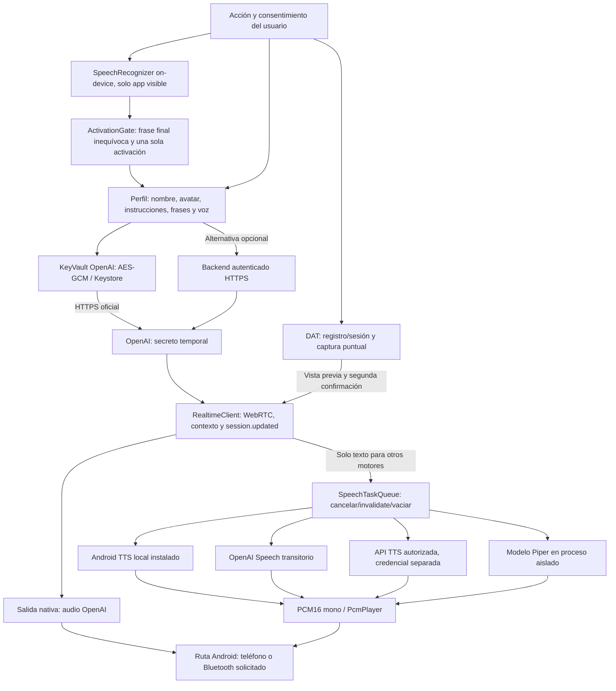

# Arquitectura · ampliación experimental 0.4.1-dev

Base de v0.4.0: `34ef4f5`. El identificador sigue siendo `com.pbtservers.pbtmetagpt`. La ampliación incorpora perfiles v2, frases múltiples y síntesis separada; no constituye certificación de audio o gafas.

## Datos y activación

`AssistantProfile` v2 conserva datos anteriores y añade frases, avatar textual, confirmación, bienvenida, duración y selección de síntesis. Se importan esquemas v1/v2 con campos permitidos, valores acotados y sin almacenes de secretos; el conjunto tiene un presupuesto de 256 KiB. Los modelos se exportan como referencia local, nunca como pesos ni código. El contexto de conversación solo vive en la conexión remota y memoria de sesión.

`ActivationPhrase` almacena texto, nombre automático, estado y principal. `PhraseMatcher` normaliza texto latino, evalúa coincidencias exactas primero y aplica tolerancia textual opcional conservadora. Ante varios perfiles candidatos se rechaza, sin desempatar por orden. `ActivationGate` consume una sola coincidencia y generaciones invalidadas impiden callbacks tardíos. No es autenticación ni detector acústico propio.

`LocalWakeListener` solo crea el reconocedor on-device; nunca fallback remoto. Una ventana de dos minutos, timeout, rearme con pausas y límite de errores acotan recursos. No guarda audio/resultados ni abre Realtime para detectar frases. El sistema selecciona la ruta del reconocedor. Se comparan todas las frases activas del grupo de idioma; solo las sugerencias Binder se acotan a 32 Ki caracteres. No hay entrenamiento por frase, sensibilidad acústica expuesta ni servicio de fondo.

## Conversación y síntesis

`RealtimeSettings` configura `output_modalities` según motor y valida lo confirmado antes de abrir el micrófono. Nativo exige audio y voz/velocidad solicitadas. Alternativo exige texto, deshabilita playout y pista remota de audio, y sintetiza únicamente respuestas completadas no canceladas. No se cambian voces silenciosamente ante errores.

`AlternativeSpeech` prepara el adaptador antes de solicitar credenciales y sintetiza mediante Android, Speech, API o `LocalModelClient`. `SpeechTaskQueue` coordina un trabajo cancelable, generación y reproductor único; descarta resultados que llegan después de detener o sustituir un trabajo. La prueba con sintetizador sustituido acredita esa coordinación, no la calidad acústica de un motor.

Los adaptadores entregan `PcmAudio` al reproductor común. La API externa tiene contrato estricto JSON/PCM16 mono, HTTPS, Content-Type y frecuencia declarada, con cuerpo limitado y HTTP cancelable. Android TTS usa voces declaradas locales/instaladas y WAV temporal privado; solo se acepta WAV PCM16 mono, se borra al cerrar/cancelar y se limpian restos al arrancar. La síntesis alternativa pausa captura mientras genera/reproduce para evitar realimentación; la interrupción manual permite escuchar si no está pausado. El texto completo sigue en el contexto aunque no se escuche entero.

## Modelos de usuario

`VoicePackageStore` acepta cuatro archivos fijos de datos. Limita descompresión, rechaza duplicados/rutas/código, verifica CRC/hashes y metadatos protobuf VITS/Piper conforme al runtime, y publica atómicamente. `PronunciationLexicon` exige palabras y símbolos cubiertos; no inventa G2P. El manifiesto declara motor/versión, RAM/idioma, autorización, licencia y procedencia. Una revisión estructural no garantiza ejecución ni derechos.

`ModelVoiceService` es un servicio no exportado con UID aislado y una instancia por petición. Solo recibe modelo/símbolos por descriptores de lectura, pronunciaciones y un pipe PCM. Copia datos a memfd propios para no abrir permisos de archivos privados de otro UID. No recibe claves o acceso a datos de la app. El runtime proviene de un AAR oficial con SHA-256 fijado, nunca del paquete.

Se acotan RAM/ABI, tamaño de modelo/diccionario, pronunciaciones Binder, salida PCM, tiempo y segmentos de inferencia. Los fallos de JNI/modelo se confinan al proceso; cancelación ordena su cierre. Los diagnósticos solo contienen etapas/tipos filtrados, no mensajes originales. CI puede mostrar logs nativos de su fixture pública sin claves reales; no se activa registro de conversaciones de usuarios.

## Seguridad y ciclo de vida

`KeyVault` separa alias/almacenes para OpenAI y API TTS. AES-256-GCM usa IV aleatorio y AAD; Keystore guarda claves no exportables por su API. Los Strings/cabeceras existen temporalmente en memoria: no hay garantía contra proceso comprometido. La credencial personal solo se transmite al host oficial; los proveedores externos requieren autorización y token propio. Revocar autorización impide nuevas síntesis; borrar local no revoca remotamente una clave.

Salir detiene reconocedor, HTTP/WebRTC, pruebas, reproducción, síntesis y cámara. Volver no reactiva sensores. La ventana local puede rearmarse al finalizar una sesión iniciada por voz, con consentimiento y visibilidad vigentes. DAT/cámara conservan registro/sesión explícitos y dos consentimientos; ninguna activación enciende la cámara.

Los informes no incluyen claves, URL personales, nombres de dispositivos, transcripciones, modelos privados ni imágenes. Los tests estructurales ficticios y la fixture real de inferencia se documentan por separado en [VALIDACION.md](VALIDACION.md). Las pruebas físicas siguen [PRUEBAS_REALES.md](PRUEBAS_REALES.md).
