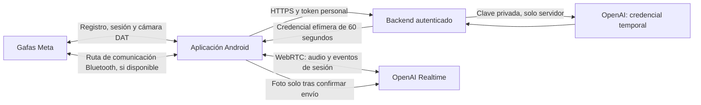

# Arquitectura de v0.2.0

## Responsabilidades

- `MainActivity`: interfaz Compose, consentimiento, permisos Android y contrato de permisos de Meta. Al pasar a segundo plano cierra voz y gafas; nunca reanuda sensores al volver.
- `MetaGlasses`: registro mediante Meta AI, flujos de dispositivos y metadatos, `AutoDeviceSelector`, `DeviceSession`, errores, timeout de conexión y captura única. La cámara se adjunta únicamente tras recibir `STARTED`, se espera `STREAMING` antes de capturar y se libera mediante `use` incluso al cancelar.
- `AudioRoute`: solicita foco transitorio, selecciona un dispositivo de comunicación Android y restaura la configuración anterior al cerrar. Si desaparece la ruta Bluetooth seleccionada se detiene la conversación; no cambia silenciosamente al micrófono del teléfono durante una sesión.
- `RealtimeClient`: credencial temporal, oferta/respuesta SDP, pista de audio y canal `oai-events`. Usa un contador de sesión para descartar callbacks antiguos tras cancelar o cerrar. Las peticiones HTTP se cancelan junto con sus corrutinas. Pausar desactiva la grabación con `PeerConnection.setAudioRecording(false)`, la pista del micrófono y limpia las colas; finalizar libera los recursos nativos. Los errores nativos de entrada/salida detienen la sesión.
- `RealtimeProtocol`: validación de URL y credenciales, eventos GA e imagen como mensaje de usuario dentro de la misma conversación.
- `backend/server.mjs`: hashes de tokens personales, límites por identidad/globales, acceso a OpenAI con timeout y respuesta mínima sin caché. No recibe audio ni fotos.

## Decisiones y límites

La aplicación y el backend mantienen la clave privada fuera de la APK. El token personal del backend se introduce en cada nueva instancia de la pantalla; no se escribe en preferencias. La única preferencia persistente es la dirección del backend. Cambiar de orientación recrea la actividad y termina la conversación deliberadamente; no hay servicio en primer plano ni escucha en segundo plano.

El contexto pertenece a una conexión Realtime. Se mantiene durante la pausa, sin reabrir otra sesión por cada frase. No se restaura después de finalizar o perder la red. Las transcripciones visibles se limitan a los últimos 4000 caracteres y no alteran el contexto conservado por OpenAI.

El audio usa WebRTC nativo con las rutas de Android. DAT se utiliza para la conexión y cámara; no se usa `mwdat-speech`. No se presupone compatibilidad de micrófonos porque exista un artefacto en Maven. La preferencia Bluetooth selecciona la primera ruta de comunicación Bluetooth disponible e informa del nombre; si hay varios auriculares deben desconectarse los que no se quieran utilizar. Antes de iniciar, si falta Bluetooth, se muestra que se utilizará el teléfono.

La foto solo se transmite tras una segunda confirmación y una sesión Realtime activa. Se codifica en JPEG con un lado máximo inicial de 512 píxeles, reduciéndose más si hace falta para mantener el mensaje bajo 64 KiB. La reducción puede impedir leer texto pequeño. El flujo de vídeo DAT necesario para la captura es local y breve; no se transmite como vídeo a OpenAI.

## Referencias contrastadas

Meta DAT Android, revisión `f4371bc9f90249d51eb07d7f8a61e8d829294f16`, muestras CameraAccess y reglas de registro/sesión, consultadas el 26 de octubre de 2026. La configuración usa las versiones del catálogo oficial de la muestra. La publicación en Maven Central y la existencia de `mwdat-speech`/`mwdat-inputs` se verificaron en el README oficial; no se deduce de ello soporte físico.

OpenAI Docs: flujo WebRTC GA, `POST /v1/realtime/client_secrets`, `POST /v1/realtime/calls`, `conversation.item.create`, `response.create`, `response.cancel`, `input_audio_buffer.clear`, `output_audio_buffer.clear` y eventos `response.output_audio_transcript.*`. No se usa la cabecera beta ni `/realtime/sessions`.
