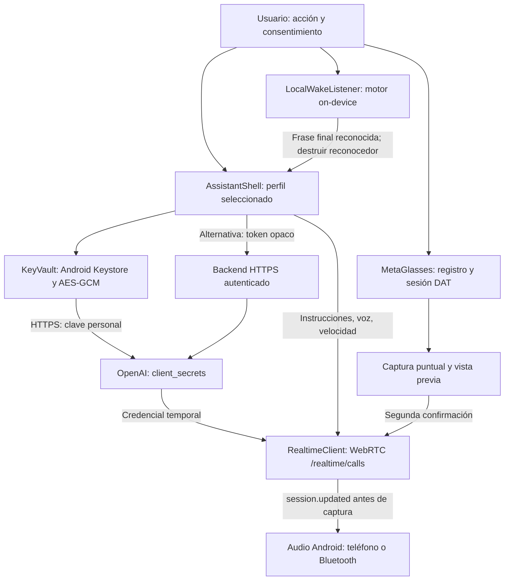

# Arquitectura de v0.4.0

Base: `f067b35` (v0.3.0). Se conservan los controladores DAT, cámara y diagnósticos. La clave OpenAI puede residir en el teléfono por elección BYOK expresa; el servidor permanece opcional.

`AssistantProfile` valida el esquema JSON y genera instrucciones; `ProfileStore` conserva la lista y selección en preferencias privadas. La importación asigna identificadores nuevos y rechaza campos extra, archivos grandes, voces/velocidades inválidas y patrones de claves. Nunca serializa `KeyVault`. Los perfiles no son secretos cifrados: los campos personales se deben tratar con cuidado.

`KeyVault` cifra con AES-GCM/128 bits de etiqueta, IV aleatorio, AAD versionada y alias de Android Keystore. No se guarda la clave personal en texto claro. Sustituir escribe una nueva envoltura autenticada; eliminar borra preferencias y alias. Una clave inválida/corrupta no se sustituye silenciosamente por una vacía. Las matrices temporales se limpian cuando es posible; los objetos String y las cabeceras HTTP pueden permanecer en memoria hasta que el recolector las libere. No hay garantía de borrado físico de memoria o flash.

El modo directo solicita credenciales temporales de 60 segundos usando la clave BYOK exclusivamente en `https://api.openai.com/v1/realtime/client_secrets`. WebRTC solo recibe el secreto efímero. El modo servidor conserva el contrato anterior. Ambos usan el perfil seleccionado y confirman `session.updated` antes de habilitar audio. La muestra de voz negocia solo recepción, no añade pista de micrófono y tiene timeout. Una sesión mantiene voz/contexto hasta su cierre; los cambios de perfil requieren reconectar.

`LocalWakeListener` solo crea el reconocedor on-device. Mantiene audio y resultados fuera del estado persistente, diagnósticos y red de la aplicación. Compara únicamente el mejor resultado final y una frase completa. No hay modelos de palabra clave propios, servicio de fondo ni fallback a un reconocedor remoto. El motor del sistema controla la ruta; no se atribuye a DAT. Ventanas de dos minutos, pausas de rearme, timeout de callbacks y límite de errores evitan espera infinita. La generación invalida callbacks antiguos después de detener/cambiar el perfil. El reconocedor se cancela y destruye antes de conectar el audio Realtime.

Solo una sesión iniciada por voz puede rearmar localmente al terminar, manteniendo consentimiento y visibilidad. Salir, navegar o desactivar revoca esa continuidad. En segundo plano se cierran reconocedor, WebRTC, pruebas locales y cámara; volver no inicia sensores. No existe foreground service porque no se ofrece escucha en segundo plano.

`Diagnostics` registra únicamente descripciones propias y códigos filtrados. Se distinguen emisión de credenciales, configuración de sesión y eventos nativos; ninguno acredita inteligibilidad ni gafas. `LocalAudioDiagnostics` usa un capturador distinto del reconocedor local y consulta su ruta específica. No se extrapola esa ruta a otro motor.

Las pruebas JVM comprueban contratos, cifrado y comparación de frases. El emulador comprueba el proveedor real Android Keystore y almacenamiento. CI usa secretos ficticios y proveedores sustituidos; los protocolos físicos permanecen independientes. Consulta [VALIDACION.md](VALIDACION.md).
